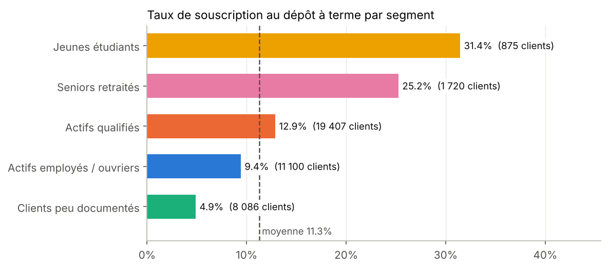
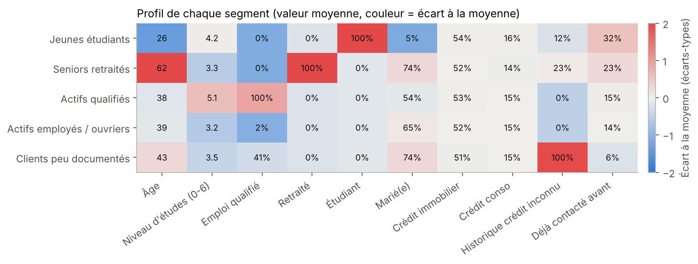
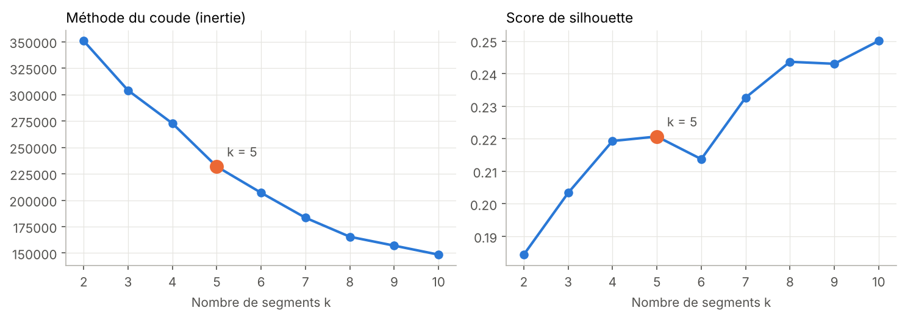
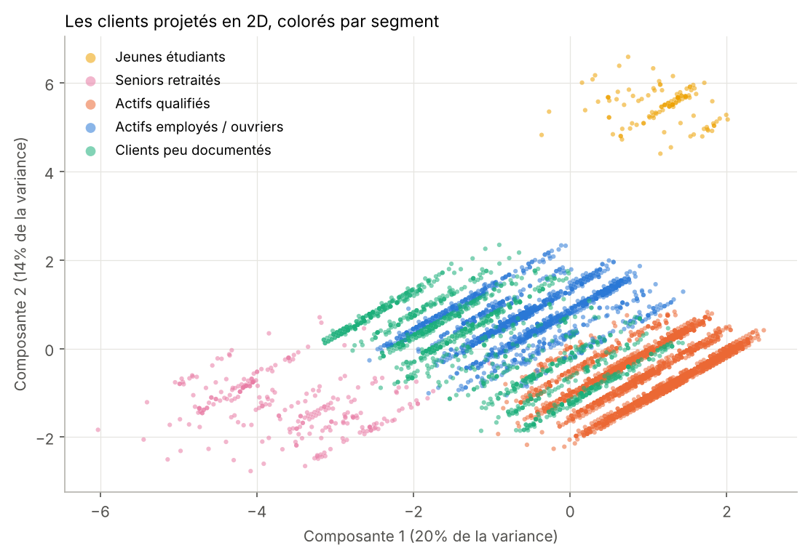

# Segmentation de clients bancaires (K-means)

> Regrouper 41 188 clients d'une banque en **5 segments** pour adapter les offres d'épargne et réduire le coût des campagnes d'appels.



## Le problème

Une banque portugaise appelle ses clients pour leur proposer un **dépôt à terme**. Seuls **11,3 %** acceptent : la majorité des appels est inutile et coûteuse. L'idée est de découper la clientèle en groupes homogènes, puis d'adapter l'offre et le canal à chaque groupe.

## Résultats

| Segment | Clients | Part | Âge moyen | Souscription | vs moyenne |
|---|---:|---:|---:|---:|---:|
| Jeunes étudiants | 875 | 2 % | 26 | **31,4 %** | × 2,8 |
| Seniors retraités | 1 720 | 4 % | 62 | **25,2 %** | × 2,2 |
| Actifs qualifiés | 19 407 | 47 % | 38 | 12,9 % | × 1,1 |
| Actifs employés / ouvriers | 11 100 | 27 % | 39 | 9,4 % | × 0,8 |
| Clients peu documentés | 8 086 | 20 % | 43 | 4,9 % | × 0,4 |

La variable de souscription **n'a pas servi** à construire les segments. Pourtant leurs taux varient de 1 à 6 : la segmentation capte un vrai comportement client.

**Impact chiffré** : ne plus appeler le segment « Clients peu documentés » économiserait **20 % des appels** pour seulement **8 % de souscriptions perdues**.



## Recommandations business

| Segment | Action proposée |
|---|---|
| **Jeunes étudiants** | Livret épargne jeune avec versements programmés, via l'app mobile et des partenariats écoles. Objectif : fidéliser avant le premier emploi. |
| **Seniors retraités** | Conseiller dédié : dépôt à terme, assurance-vie, transmission. Canal téléphone ou agence. |
| **Actifs qualifiés** | Offres digitales (épargne en ligne, PEA, packs premium) et ciblage par scoring plutôt qu'appels de masse. |
| **Actifs employés / ouvriers** | Produits simples à petits montants (épargne automatique, arrondi des achats) et éducation financière. |
| **Clients peu documentés** | Compléter d'abord la connaissance client (KYC, historique de crédit). Les retirer des campagnes d'appels. |

## Démarche

1. **Exploration** : 41 188 clients, 21 colonnes, cible déséquilibrée (11 % de « oui »).
2. **Variables** : 10 variables décrivant le *client* (âge, niveau d'études, type d'emploi, situation familiale, crédits en cours, historique de crédit connu ou non, contact passé). Exclues : la durée d'appel (connue seulement après coup, donc fuite d'information) et les indicateurs macro-économiques.
3. **Standardisation** : moyenne 0 et écart-type 1, car K-means repose sur des distances.
4. **Choix de k** : méthode du coude et score de silhouette pour k de 2 à 10. **k = 5** : coude de l'inertie, premier pic de silhouette et nombre de segments exploitable par une équipe marketing.
5. **K-means** (`n_init=20`, graine fixe), puis profil de chaque segment et nom métier.
6. **Validation business** : taux de souscription et *lift* par segment.





## Structure du projet

```
segmentation-clients-bancaires/
├── data/
│   ├── bank-additional-full.csv     # données UCI (41 188 lignes)
│   └── telecharger_donnees.py       # re-télécharge le CSV si besoin
├── notebooks/
│   └── segmentation_clients.ipynb   # analyse complète commentée
├── src/
│   └── segmentation.py              # pipeline réutilisable
├── figures/                         # graphiques générés
├── resultats/
│   ├── profils_segments.csv
│   ├── recommandations.csv
│   └── segment_par_client.csv
├── requirements.txt
└── README.md
```

## Lancer le projet

```bash
python -m venv .venv
source .venv/bin/activate        # Windows : .venv\Scripts\activate
pip install -r requirements.txt

python -m src.segmentation       # régénère figures/ et resultats/
jupyter notebook notebooks/segmentation_clients.ipynb
```

## Limites et suite

- K-means est conçu pour des variables continues, or la plupart des variables ici sont binaires. Des méthodes pour données mixtes (**K-prototypes**, distance de Gower) seraient plus rigoureuses.
- Le jeu ne contient ni revenus ni encours : une vraie banque segmenterait aussi sur la **valeur client**.
- Tester la **stabilité** des segments (autres graines, bootstrap).
- Prochaine étape : un **modèle de scoring** (régression logistique, XGBoost) pour prioriser les appels à l'intérieur de chaque segment.

## Compétences mobilisées

Python · pandas · scikit-learn (K-means, ACP, silhouette) · matplotlib · feature engineering · traduction de résultats statistiques en décisions business.

## Source des données

S. Moro, P. Cortez, P. Rita (2014). *A Data-Driven Approach to Predict the Success of Bank Telemarketing*. Decision Support Systems. Jeu [Bank Marketing](https://archive.ics.uci.edu/dataset/222/bank+marketing) de l'UCI Machine Learning Repository, licence CC BY 4.0.

---
*Projet réalisé par Issa Aziz KARAMBIRI, élève ingénieur en mathématiques appliquées (data, IA, finance).*
